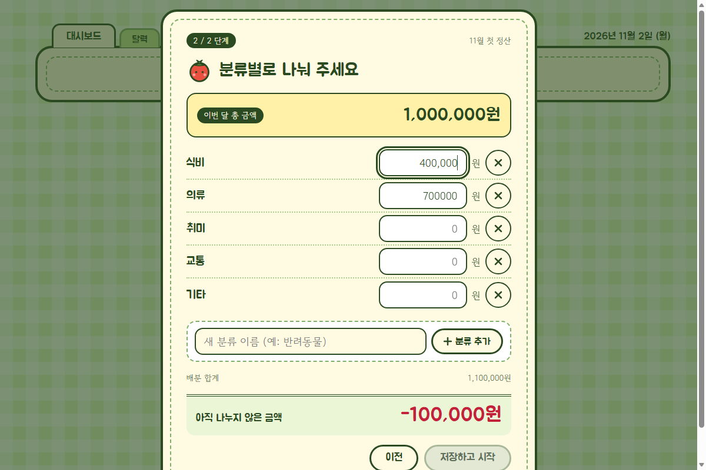
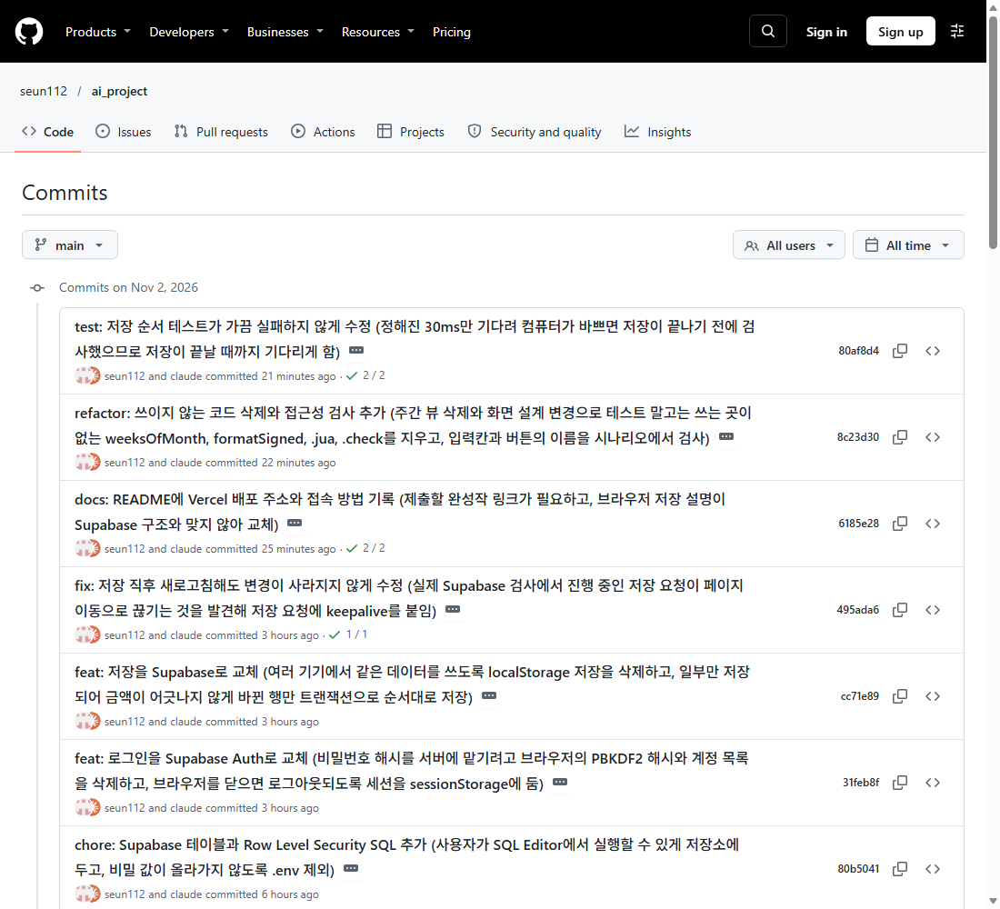

# 생활비 관리 시스템

## 소개

매달 쓸 수 있는 총 금액을 먼저 정하고, 분류별로 나눠 쓰면서 남은 돈과 초과분을 한눈에 관리하는 웹 앱입니다.

**완성작:** https://aiproject-v5el.vercel.app/

- 위 주소에 접속해 이메일과 비밀번호(8자 이상)로 회원가입하면 바로 시작합니다. 확인 메일은 없고 설치도 필요 없습니다.
- 브라우저를 닫으면 로그아웃되고, 다시 로그인하면 내 데이터를 불러옵니다.
- 로그인과 데이터 저장은 Supabase, 배포는 Vercel을 씁니다. 계정마다 자기 데이터만 읽고 쓸 수 있습니다.
- 프레임워크 없이 HTML, CSS, JS를 한 파일(`index.html`)에 담습니다.

## 화면

| 로그인 | 매달 첫 정산 |
|---|---|
|  |  |

| 분류별 배분 | 대시보드 |
|---|---|
|  |  |

| 달력 | 설정 |
|---|---|
|  |  |

## 커밋 내역

작업 단위마다 `<타입>: <무엇을 왜 했는지>` 형식으로 커밋했습니다. 전체 내역은 [GitHub 커밋 목록](https://github.com/seun112/ai_project/commits/main)에서 볼 수 있습니다.



## PRD

원본은 [PRD.md](PRD.md)입니다.

<details>
<summary>PRD 전문 펼치기</summary>

### PRD: 생활비 관리 시스템

> 이 문서는 화면 설계(`docs/mockup.html`, `docs/design.md`)를 확정한 뒤 다시 쓴 버전이다.
> 처음 계획과 달라진 점은 `TODO.md`의 "변경 내역"에 모두 기록했다.

#### 1. 개요

- **목적**: 매달 쓸 수 있는 총 금액을 먼저 정하고, 분류별로 나눠 쓰면서 남은 돈과 초과분을 한눈에 관리하는 웹 앱
- **기준 화면**: 데스크톱 (좁은 화면에서 깨지지 않을 정도의 반응형만 지원)
- **계정**: 이메일과 비밀번호로 로그인한다. 이메일 확인 메일은 보내지 않고, 소셜 로그인은 없다.
- **저장**: 사용자별 데이터를 **DB**에 저장한다. (과제 필수 요건)
- **배포**: 서버에 **배포**해서 인터넷 주소로 접속한다. (과제 필수 요건)
- **개발 순서**: 화면과 기능은 먼저 브라우저 저장(localStorage)으로 만들고, 마지막에 로그인·DB·배포를 붙인다. 저장 코드는 `loadData`/`saveData` 한 곳에 모아 교체하기 쉽게 한다.
- **통화**: 원(₩), 정수만 허용

#### 2. 화면 구성

| 화면 | 언제 보이나 | 내용 |
|---|---|---|
| 로그인 / 회원가입 | 로그인하지 않았을 때 | 이메일, 비밀번호, 오류 안내 |
| 정산 이벤트 창 | 로그인 후, 그 달 정산이 끝나지 않았을 때 (매달 첫 접속) | 1단계 지난달 처리 + 총 금액, 2단계 분류 배분 |
| 대시보드 | 매일 쓰는 메인 | 오늘 지출 입력, 오늘 쓴 돈, 이번 달 남은 돈, 저금통 잔액, 분류별 남은 돈 |
| 달력 | 탭 | 날짜별 지출 합계, 선택한 날의 내역, 이번 달 지출 추가·수정·삭제, 지난달 열람 |
| 설정 | 탭 | 이번 달 총 금액과 분류별 배분 수정 |

- 상단 폴더 탭은 `대시보드`, `달력`, `설정` 세 개다.
- 로그아웃 버튼은 두지 않는다.

#### 3. 핵심 사용 흐름

1. 이메일과 비밀번호로 로그인한다. (처음이면 회원가입)
2. 그 달 첫 접속이면 **정산 이벤트 창**이 대시보드 위에 뜬다. 끝내기 전에는 닫을 수 없다.
3. 정산을 마치면 대시보드가 보이고, 매일 지출을 입력한다.
4. 달력으로 날짜별 지출을 보고 빠뜨린 지출을 넣거나 고치고, 설정에서 이번 달 금액을 고칠 수 있다.
5. 다음 달 첫 접속에서 2번으로 돌아간다.

#### 4. 기능 요구사항

##### FR-1. 로그인과 회원가입

- 이메일: **이메일 형식**이어야 한다. 대문자로 입력해도 소문자로 맞춰서 비교하고, 이미 가입된 이메일은 가입할 수 없다.
- 비밀번호: **8자 이상**. 회원가입에서는 한 번 더 입력해 같은지 확인한다.
- 오류는 해당 입력칸 아래에 빨간 글씨 한 줄로 보여주고, 그 칸의 테두리도 빨갛게 한다.

| 상황 | 안내 문구 |
|---|---|
| 이메일 비어 있음 | 이메일을 입력해 주세요. |
| 비밀번호 비어 있음 | 비밀번호를 입력해 주세요. |
| 이메일 형식이 아님 | 이메일 형식으로 입력해 주세요. |
| 이미 가입된 이메일로 가입 | 이미 가입된 이메일이에요. |
| 비밀번호 8자 미만 | 비밀번호는 8자 이상으로 만들어 주세요. |
| 비밀번호 확인 비어 있음 | 비밀번호를 한 번 더 입력해 주세요. |
| 비밀번호 확인이 다름 | 비밀번호가 서로 달라요. |
| 로그인 실패 (없는 이메일, 틀린 비밀번호) | 이메일 또는 비밀번호가 맞지 않아요. (두 칸 모두 빨간 테두리) |
| 서버 오류, 연결 실패 | 지금은 처리할 수 없어요. 잠시 후 다시 시도해 주세요. |

- 이메일 확인 메일은 보내지 않는다. (Supabase의 "Confirm email"은 끈다.) 가입에 성공하면 바로 로그인된 상태로 정산 창 또는 대시보드로 들어간다.
- 로그인 상태는 **브라우저를 닫으면 끝난다.** 다음에 열면 다시 로그인한다.
- 비밀번호는 Supabase Auth가 **암호화(해시)해서** 저장한다. 화면과 저장소 코드에 비밀번호를 그대로 두지 않는다.

##### FR-2. 정산 이벤트 창 (매달 첫 접속)

- 이번 달 정산이 끝나지 않았으면 대시보드 위에 어두운 막과 함께 뜬다. 닫기 버튼이 없고, 끝내야 닫힌다.
- 단계는 **1단계(지난달 처리 + 총 금액)** 와 **2단계(분류 배분)** 두 개다. 처음 쓰는 달도 같은 두 단계이고, 지난달 결과 부분만 없다.
- 입력 중인 값은 저장하지 않고 마지막 `저장하고 시작`에서 한 번에 기록한다. 중간에 새로고침하면 처음부터 다시 뜬다.

**1단계: 지난달 처리**

| 지난달 결과 | 화면 | 규칙 |
|---|---|---|
| 남은 돈이 있음 (+) | `10월 남은 돈 +○원` 아래에서 `저금통에 저축`과 `다음 달로 이월` 금액을 입력 | **저축 + 이월 = 남은 금액**이어야 `다음`이 활성화된다. 다르면 총 금액 아래에 안내가 나온다. |
| 초과 지출 (−) | `10월 초과 지출 −○원` 아래에서 아래 셋 중 하나 선택 (라디오) | 아래 표 참고 |
| 처음 쓰는 달 | "처음 쓰는 달이라 지난달 결과가 없어요." 안내만 | 총 금액만 정한다. |
| 0원으로 딱 맞음 | 지난달 처리 부분 없이 총 금액만 | 총 금액만 정한다. "처음 쓰는 달" 안내 문구는 보이지 않는다. |

초과 처리 선택지:

| 선택 | 저금통에서 | 다음 달 총 금액에서 | 기록 |
|---|---|---|---|
| 다음 달 총 금액에서 차감 | 0 | 초과분 전체 | 없음 |
| 그냥 두기 | 0 | 0 | 미정산 금액으로 기록만 남김 (다음 달 예산에는 영향 없음) |
| 저금통에서 차감하고 나머지는 다음 달에서 차감 | `p`원 | `초과 − p`원 | 없음 |

- `p`는 저금통 잔액과 초과분 중 작은 값 이하여야 한다.
- 저금통에서 뺄 금액 입력칸은 세 번째 선택지를 골랐을 때만 열린다.

**1단계: 이번 달 총 금액**

- `기본 금액`을 입력하면 `지난달에서 이월`, `지난달 초과분 차감`과 함께 계산해서 이중선 아래에 크게 보여준다.
- `이번 달 총 금액 = 기본 금액 + 이월액 − 차감액`, **1원 이상**이어야 한다.

**2단계: 분류별 배분**

- 분류마다 금액을 입력한다. 빈칸은 0원으로 본다.
- 배분 합계와 **아직 나누지 않은 금액**을 입력할 때마다 보여준다. 총 금액보다 많이 나누면 `-`로 표시하고 빨간색으로 보인다.
- **합계 = 총 금액**일 때만 `저장하고 시작`이 활성화된다.
- 금액이 올바르지 않을 때만(소수점, 음수, 글자) 입력칸 테두리와 안내가 나온다.
- 분류 추가와 삭제는 FR-8에 따른다.
- `이전`으로 1단계에 돌아가도 입력값은 유지된다.

##### FR-3. 지출 입력·수정·삭제

- 입력 항목: **분류**(칩으로 하나 선택), **금액**(원 정수, 1원 이상), **메모**(선택, 30자 이내)
- **대시보드**: 오늘 날짜로만 입력한다. (날짜 선택 없음) 오늘 쓴 내역 목록에서 `×` 버튼으로 삭제할 수 있다.
- **달력**: 이번 달에서 **오늘까지의 날짜**를 선택하면 그날의 지출을 **추가, 수정, 삭제**할 수 있다. (FR-5 참고) 빠뜨린 지출을 나중에 넣거나 잘못 넣은 지출을 고칠 때 쓴다.
- 오늘 이후(미래) 날짜와 지난달 이전 기록은 추가, 수정, 삭제 모두 할 수 없다.
- 분류 배분액을 넘겨도 입력은 허용한다.
- Enter 키로도 추가·저장된다.

##### FR-4. 대시보드

- **오늘 쓴 돈**: 오늘 입력한 지출의 합계
- **오늘 지출 입력**과 **오늘 내역** (FR-3)
- **이번 달 남은 돈**: 가장 크게 보여주는 숫자. 음수면 `-`와 빨간색. 아래에 사용 비율 막대와 "총 ○원 중 ○원 사용", "○% 썼어요"
- **저금통 잔액**: 숫자만 보여준다. (버튼 없음)
- **분류별 남은 돈**: 분류마다 남은 금액, 막대, "배분 ○원 · 사용 ○원". 초과한 분류는 `-○원`, 빨간색, `초과` 라벨을 같이 붙여 색만으로 구분하지 않게 한다.
- 정산에서 "그냥 두기"로 기록된 **미정산 금액은 화면에 보여주지 않는다.** (데이터에만 남긴다.)

##### FR-5. 달력

- 월 달력, **월요일부터 일요일** 순서
- **모든 날짜 칸**에 그날의 총 사용 금액을 보여준다. 쓴 돈이 없는 날은 연하게 `0`. 지출이 있는 날은 연두색 칸, 오늘은 굵은 테두리와 `오늘` 표시
- 날짜를 누르면 **오른쪽**에 그날의 합계와 내역(분류, 메모, 금액)이 나온다. 좁은 화면에서는 달력 아래로 내려간다.
- **이번 달, 오늘까지의 날짜**:
  - 내역마다 연필(수정)과 `×`(삭제) 버튼이 있다.
  - 수정을 누르면 그 줄이 `지출 수정` 상자로 바뀐다. 분류, 금액, 메모를 고치고 `저장` 또는 `취소`한다.
  - 내역 아래의 `이 날 지출 추가` 상자에서 분류, 금액, 메모를 넣고 `추가`한다.
  - 금액 오류는 입력칸 아래에 안내한다. (FR-3의 입력 규칙과 같다.)
  - 저장·추가·삭제하면 달력 칸의 합계, 이 달 쓴 돈, 이번 달 남은 돈, 대시보드가 바로 바뀐다.
- **미래 날짜**: 날짜 칩과 `0원`, "이 날은 쓴 돈이 없어요.", "아직 오지 않은 날이에요.", 맨 아래 `이번 달 남은 돈`이 보인다. 연필·`×` 버튼과 `이 날 지출 추가` 상자는 없다.
- 위쪽에 `<`, `>` 버튼과 "이 달 쓴 돈". 데이터가 있는 가장 이른 달 이전과 이번 달 이후로는 넘어갈 수 없다.
- 이번 달: 오른쪽 아래에 "이번 달 남은 돈"을 보여준다.
- 지난달: **읽기 전용**이고 "지난달 기록 · 볼 수만 있어요" 라벨을 보여준다. 추가·수정·삭제 버튼과 입력 상자가 없다.

##### FR-6. 설정 (이번 달 금액 수정)

- `이번 달 총 금액`과 분류별 배분을 고칠 수 있다.
- 분류마다 "사용 ○원"을 같이 보여준다.
- 아직 나누지 않은 금액이 **0원**이고, 총 금액이 **1원 이상**이고, **바뀐 내용이 있을 때**만 `저장`이 활성화된다. 안내 문구로 이유를 보여준다. (예: "50,000원을 더 나눠야 저장할 수 있어요.", "바꾼 내용이 없어요.")
- 이미 쓴 금액보다 적게 배분하거나 총 금액을 이미 쓴 돈보다 적게 정해도 저장된다. 그 분류와 남은 돈은 `-`로 표시된다.
- 오른쪽 미리보기에 `현재 ○원 → 변경 ○원`과 바뀐 이번 달 남은 돈을 보여준다.
- 지난달 기록은 수정할 수 없다. ("지난달 기록은 수정할 수 없어요" 라벨)
- 저장하면 대시보드로 돌아가고, 이미 쓴 지출은 그대로 남는다.
- `취소`는 저장하지 않고 대시보드로 돌아간다.

##### FR-7. 저금통

- 저금통은 **정산 이벤트 창에서만** 변한다. (남은 돈 저축, 초과분 차감)
- 대시보드에 잔액만 보여준다. 저금통 화면과 `사용하기`는 없다.
- 정산 때 일어난 저축과 차감은 내역으로 기록한다. (`save`, `deficit`)

##### FR-8. 분류 관리 (정산 이벤트 창 2단계)

- 기본 분류: **식비, 의류, 취미, 교통, 기타** 다섯 개
- **추가**: 이름을 입력하고 `분류 추가`. 빈 이름, 10자 초과, 이미 있는 이름은 안내와 함께 막는다.
- **삭제**: 분류 옆 `×` 버튼을 누르면 "○○ 분류를 삭제할까요?" 확인이 나오고, 확인하면 삭제된다. 분류가 하나 남으면 삭제할 수 없다.
- 삭제한 분류는 **이번 달부터** 목록에서 빠지고, 이미 쓴 내역은 지난 기록에 그대로 남는다. 지출 내역이 있는 분류는 실제로 지우지 않고 숨김 처리한다.
- 설정 화면에서는 분류를 추가·삭제하지 않는다. (금액만 수정)

#### 5. 계산 규칙

```
총 잔액     = 이번 달 총 금액 − 이번 달 전체 지출 합계
분류 잔액   = 분류 배분액 − 분류 지출 합계   (초과 시 음수)
총 금액     = 기본 금액 + 이월액 − 차감액
```

- 잔액은 **저장하지 않고 매번 계산**한다.
- 분류 초과분은 총 잔액에서 자동으로 감액된다. (분류 잔액의 합 = 총 잔액)
- 이월금은 총 금액에만 더해지고, 분류 배분은 매달 새로 한다.
- 달력과 대시보드의 이번 달 계산은 **이번 달 날짜의 지출만** 합친다.

예시: 총 100만 원, 식비 40만 / 의류 60만 배분 → 식비 45만, 의류 10만 지출
→ 식비 잔액 **−5만**, 의류 잔액 **+50만**, 총 잔액 **45만**

#### 6. 예외 상황

| 상황 | 처리 |
|---|---|
| 처음 쓰는 달 (이전 정산 없음) | 지난달 처리 없이 총 금액만 정한다. |
| 한 달 이상 건너뛰고 접속 | 비어 있는 달은 지출 0원, 총 금액 미설정으로 자동 마감하고, 마지막으로 정산된 달의 결과만 정산 대상으로 한다. |
| 정산 도중 새로고침 | 정산이 끝나지 않은 상태로 유지되고 창이 처음부터 다시 뜬다. |
| 금액에 소수점, 음수, 문자 입력 | 입력을 거부하고 해당 칸 아래에 안내한다. |
| 저장 실패 (네트워크 오류 등) | 화면 위에 "저장하지 못했습니다" 안내를 띄우고, 다음 저장 때나 인터넷이 돌아오면 다시 보낸다. |
| 데이터 불러오기 실패 | "데이터를 불러오지 못했어요" 안내와 `다시 시도` 버튼만 보여 준다. 데이터를 지우는 초기화 기능은 두지 않는다. |

#### 7. 데이터 모델

```js
{
  users: [{ id, email, createdAt }],                        // Supabase Auth가 관리, 비밀번호 해시는 Supabase에만 저장
  categories: [{ id, userId, name, hidden }],
  months: {
    "2026-11": {
      userId, baseAmount, carryIn, deduction, total,
      allocations: { [categoryId]: amount },                 // 합 = total
      settled: true
    }
  },
  expenses: [{ id, userId, date: "2026-11-14", categoryId, amount, memo }],
  piggy: {
    userId, balance,
    history: [{ id, date, type: "save|deficit", amount, memo }]
  },
  unsettled: [{ userId, month: "2026-10", amount }]
}
```

- 모든 데이터는 `userId`로 구분하고, 다른 사용자의 데이터는 읽거나 쓸 수 없다.
- 개발 단계의 브라우저 저장에서는 계정마다 따로 저장한다.

#### 8. 비기능 요구사항

- 데스크톱 브라우저 기준. 창을 좁혀도 가로 스크롤이 생기거나 글자가 겹치지 않는 정도로만 대응한다.
- 금액은 천 단위 쉼표와 `원`을 붙여 표시한다. (예: `1,200,000원`)
- 글꼴은 Google Fonts의 `Jua`(제목, 강조 숫자)와 `Gowun Dodum`(본문)을 쓰고, 불러오지 못하면 `Malgun Gothic`으로 대신한다.
- 키보드 포커스가 보여야 하고, 오류와 안내는 색만이 아니라 글자로도 전달한다.
- DB 접속 비밀번호, 서비스 키 같은 비밀 값은 **저장소에 올리지 않고** 호스팅 서비스의 환경 변수로 넣는다. (`.env`는 `.gitignore`)
- 서버에 배포해 인터넷 주소로 접속할 수 있어야 한다.

#### 9. 범위 제외

- 주간 화면과 주간 합계
- 저금통 화면, 저금통 `사용하기`
- 로그아웃 버튼, 소셜 로그인, 이메일 인증, 비밀번호 찾기
- 지난달 데이터 수정
- 대시보드에서 오늘이 아닌 날짜로 입력 (다른 날짜는 달력에서 한다)
- 미정산 금액을 보여주는 화면
- 설정 화면에서의 분류 추가·삭제와 이름 수정
- 모바일 전용 화면
- 소수점 금액, 외화
- 분류별 이월
- (선택) 백업 JSON 내보내기·가져오기 — 시간이 남을 때만

#### 10. 수용 기준 (테스트 시나리오)

1. 이메일 형식이 아니면 가입과 로그인이 막힌다. 대문자로 입력해도 같은 이메일로 처리된다.
2. 이미 가입된 이메일로 가입할 수 없고, 비밀번호가 8자 미만이거나 확인과 다르면 가입할 수 없다. 가입하면 확인 메일 없이 바로 로그인된다.
3. 틀린 비밀번호로 로그인하면 "이메일 또는 비밀번호가 맞지 않아요."가 나온다.
4. 다른 계정으로 로그인하면 그 계정의 데이터만 보인다.
5. 매달 첫 접속에서만 정산 창이 뜨고, 끝내기 전에는 닫을 수 없다.
6. 남은 돈은 저축 + 이월 = 남은 금액일 때만 다음으로 넘어가고, 저금통 잔액과 다음 달 총 금액에 각각 반영된다.
7. 초과 처리 세 가지가 각각 맞게 반영된다. 저금통 + 다음 달 차감은 합이 초과분과 같고, 저금통에서 뺄 금액은 잔액이나 초과분보다 클 수 없다.
8. 분류 합계가 총 금액과 다르면 `저장하고 시작`이 비활성이다.
9. 분류를 추가·삭제할 수 있고, 빈 이름·10자 초과·중복 이름은 막힌다. 삭제 전에 확인이 나온다.
10. 분류 초과 지출을 입력하면 해당 분류가 `-`와 `초과`로 표시되고 이번 달 남은 돈이 그만큼 줄어든다.
11. 대시보드의 오늘 내역에서 지출을 삭제하면 오늘 쓴 돈과 남은 돈이 바로 바뀐다.
12. 달력의 모든 날짜 칸에 그날 합계가 보이고, 날짜를 누르면 오른쪽에 내역이 나온다.
13. 지난달 달력은 볼 수만 있고, 지난달 지출은 추가·삭제·수정할 수 없다. 오늘 이후 날짜에는 입력 상자가 없다.
14. 설정에서 총 금액과 배분을 고칠 수 있고, 합계가 맞을 때만 저장된다. 이미 쓴 돈보다 적게 배분해도 저장되며 초과로 표시된다.
15. 두 달 이상 건너뛰고 접속해도 마지막 정산 달 기준으로 정산이 진행된다.
16. 배포한 주소에서 같은 기능이 그대로 동작하고, 새로고침해도 데이터가 DB에서 다시 불러와진다.
17. 달력에서 이번 달의 오늘까지 날짜에 지출을 추가·수정·삭제할 수 있고, 달력 칸 합계와 이번 달 남은 돈, 대시보드가 바로 바뀐다. 금액을 잘못 넣으면 안내가 나온다.

#### 11. 아직 정하지 못한 것

- **DB·서버 구조 (확정)**: 과제 안내문을 확인해 직접 만든 서버 없이 **DB와 로그인은 Supabase, 배포는 Vercel**을 쓴다. 제출은 GitHub 저장소로 하고 README에 완성작 링크를 올린다.
- **비밀번호를 잊었을 때**: 비밀번호 찾기가 없다.

</details>

## 처음 계획

원본은 [docs/initial-todo.md](docs/initial-todo.md)이고, 현재 계획은 [TODO.md](TODO.md)입니다.

<details>
<summary>처음 계획 펼치기</summary>

### Todo 리스트

> 푸시 단위는 Todo 하나(또는 그 묶음)다. 작업 중 계획이 바뀌면 아래 **변경 내역**에 반드시 기록한다.

#### 진행 규칙

- 작업 단위마다 커밋하고, 푸시는 아래 **푸시 시점**마다 한다.
- 커밋 메시지 형식: `<타입>: <무엇을 왜 했는지>`
  - 타입: `feat`, `fix`, `docs`, `refactor`, `test`, `chore`
  - 예: `feat: 분류 배분 합계 검증 추가 (총 금액과 불일치 시 저장 차단)`
- Todo가 바뀌면 이 파일의 변경 내역도 **같은 커밋**에 포함한다.

#### 초기 Todo (처음 계획)

##### T0. 프로젝트 준비 (푸시 1)
- [ ] Git 저장소 초기화, `.gitignore`
- [ ] `PRD.md`, `TODO.md` 추가
- [ ] `README.md` 뼈대 (소개, PRD/Todo, 변경 내역, 스킬, 느낀 점 섹션)
- [ ] 커밋 규칙, 스킬 계획 정리

##### T1. 데이터 모델과 저장 (푸시 2)
- [ ] `index.html` 기본 골격 (HTML, CSS, JS 한 파일)
- [ ] 데이터 구조 정의 (categories, months, expenses, piggy, unsettled)
- [ ] localStorage 저장/불러오기, 버전 필드
- [ ] 금액 검증 유틸 (원 단위 정수만), 금액 포맷 유틸
- [ ] 월/주 계산 유틸 (월~일 기준)

##### T2. 정산 마법사 (푸시 3)
- [ ] 새 달 첫 접속 감지, 마법사 자동 실행
- [ ] 첫 실행 시 지난달 결과 단계 건너뛰기
- [ ] 총 금액 설정 (기본 금액 + 이월 − 차감)
- [ ] 분류별 배분 입력, 미배분 금액 실시간 표시
- [ ] 합계 검증 (합계 ≠ 총 금액이면 저장 차단)

##### T3. 지출과 대시보드 (푸시 4)
- [ ] 지출 입력/수정/삭제 모달
- [ ] 날짜 범위 제한 (이번 달만), 지난달 잠금
- [ ] 총 잔액, 분류별 잔액 계산
- [ ] 분류 초과 시 `-` 표기와 빨간색, 경고 표시
- [ ] 진행 바

##### T4. 달력과 주간 뷰 (푸시 5)
- [ ] 월 달력, 날짜별 합계
- [ ] 날짜 클릭 시 일별 지출 목록
- [ ] 주간 뷰 (월~일), 일별/분류별 합계
- [ ] 월 경계 주 처리, 이전 달 열람 (읽기 전용)

##### T5. 저금통 (푸시 6)
- [ ] 저축 시 잔액 합산, 내역 기록
- [ ] 사용하기 (메모 + 금액), 잔액 초과 차단
- [ ] 내역 목록 (save / use / deficit)

##### T6. 월말 정산 로직 (푸시 7)
- [ ] 남은 돈: 저금통 저축 + 이월 분배 (합 = 남은 금액)
- [ ] 초과 지출: 다음 달 차감 / 미정산 기록 / 저금통 차감
- [ ] 저금통 차감 + 남은 초과분 자동 다음 달 차감 처리
- [ ] 미정산 금액 기록과 대시보드 표시
- [ ] 건너뛴 달 자동 마감

##### T7. 테스트와 다듬기 (푸시 8)
- [ ] PRD 수용 기준 8개 시나리오 수동 테스트
- [ ] 월 전환 시나리오 테스트 (날짜를 바꿔서 검증)
- [ ] 버그 수정
- [ ] 분류 관리 (추가/수정/숨김)
- [ ] 반응형, 디자인 다듬기
- [ ] (여유 시) JSON 백업 내보내기/가져오기

##### T8. 문서 마무리 (최종 푸시)
- [ ] README 완성: 소개, PRD/Todo, 변경 내역
- [ ] 스킬 섹션: SKILL.md 내용과 사용 방식, 선택/제작 이유
- [ ] 느낀 점과 결론

#### 사용할 스킬 (계획)

| 스킬 | 구분 | 용도 |
|---|---|---|
| `frontend-design` | 기존 스킬 | T1, T3, T7에서 UI 방향, 타이포, 색상 결정 |
| `todo-commit-workflow` | 직접 제작 | Todo 완료 시 변경 내역 기록과 커밋 메시지 작성을 같은 절차로 반복 |

</details>

## 변경 내역

처음 계획과 달라진 점과 그 이유입니다.

<details>
<summary>변경 내역 펼치기</summary>

| 시점 | 구분 | 항목 | 변경 내용 | 이유 |
|---|---|---|---|---|
| T0 | 추가 | 세부 규칙 2건 확정 | PRD 10장에 기록: ① 저축+이월은 남은 금액 전액 배분 ② 저금통 차감 후 남은 초과분은 자동으로 다음 달 차감 | 처음 설명에 없던 세부 규칙을 사용자 확인 후 명시하기 위해 |
| T0 | 변경 | 저장소 초기화 | 새로 초기화하지 않고 원격 `main` 이력 위에서 시작 | 원격에 이미 커밋과 README가 있어서 |
| T0 | 변경 | PRD 초과분 규칙 | PRD FR-1과 10장을 자동 다음 달 차감으로 수정 | PRD와 TODO의 내용이 달라서 |
| T0 | 변경 | README | 뼈대로 교체하고, T8에서 PRD 전문과 초기 Todo(`docs/initial-todo.md`)를 README에 직접 포함 | README 하나에서 PRD와 처음 계획을 바로 볼 수 있게 하기 위해 (※ 문서 단계는 설계 변경으로 T12로 번호가 바뀜) |
| T0 | 추가 | 스킬 제작 | T0에 `todo-commit-workflow` 스킬 제작 항목을 추가하고 `SKILL.md` 작성 | 스킬 제작을 T0에서 끝내기로 해서 |
| T1 전 | 추가 | 초기 Todo 보존 | 첫 커밋의 계획을 `docs/initial-todo.md`로 저장 | 처음 계획과 현재 Todo를 비교할 수 있게 하기 위해 |
| T1 전 | 추가 | 스킬 원문 보존 | `frontend-design` 원문과 라이선스를 `docs/skills/`에 저장 | 플러그인 설치 없이 저장소에서 참고한 스킬을 확인할 수 있게 하기 위해 |
| T1 | 변경 | 손상 데이터 복구 | T1에는 초기화만 넣고, 백업 JSON 가져오기는 T7에서 구현할 때 이 오류 화면에 연결 | JSON 가져오기가 T7의 선택 항목이라서 (※ 선택 항목은 현재 T11) |
| T1 후 | 추가 | 검증 스크립트 | 임시 폴더의 유틸 테스트와 브라우저 확인 스크립트를 `tests/`로 옮겨 커밋 | T1 계획은 커밋하지 않기로 했지만, 저장소에서 같은 검증을 다시 실행할 수 있게 하기 위해 |
| 설계 확정 | 추가 | 화면 설계와 목업 | 화면을 먼저 설계하고 동작 목업(`docs/mockup.html`)과 화면 문서(`docs/design.md`)를 구현 기준으로 추가 | 구현 전에 화면을 사용자가 직접 보고 정하기 위해 |
| 설계 확정 | 변경 | 정산 마법사 → 정산 이벤트 창 | 전체 화면 마법사 대신 **매달 첫 접속에만** 대시보드 위에 뜨는 창으로 바꿈. 닫기 버튼이 없어 끝내야 닫힘 | 정산은 한 달에 한 번이고, 매일 쓰는 메인 화면이 따로 필요해서 |
| 설계 확정 | 변경 | 정산 단계 구성 | "지난달 결과 → 총 금액 → 배분" 3단계를 **1단계(지난달 처리 + 총 금액), 2단계(분류 배분)** 로 합침. 처음 쓰는 달은 지난달 부분만 빠짐 | 지난달 처리 결과가 총 금액에 바로 반영되는 걸 한 화면에서 보며 정하려고 |
| 설계 확정 | 변경 | 디자인 | 종이 통장(옅은 청록·소나무색) → **연두색 체크 바탕 + 바인더 노트 + 폴더 탭 + 토마토 캐릭터**, 글꼴 `Jua`/`Gowun Dodum` | 사용자가 고른 레퍼런스(미니홈피·노트 느낌)를 따르기 위해 |
| 설계 확정 | 변경 | 기준 화면 | 모바일 시안을 빼고 **데스크톱 기준**으로 변경, 좁은 화면은 깨지지 않는 정도만 지원 | 사용자 결정 |
| 설계 확정 | 추가 | 분류 | 기본 분류에 **교통** 추가 (식비·의류·취미·교통·기타) | 사용자 요청 |
| 설계 확정 | 추가 | 분류 추가·삭제 | 정산 창 2단계에서 분류를 추가·삭제 (삭제 확인, 이름 10자 이하·중복 불가, 최소 1개 유지) | 사용자 요청 |
| 설계 확정 | 변경 | 분류 관리 위치 | 설정 화면의 분류 관리(처음 FR-7) 대신 정산 창에서 추가·삭제. 이름 수정과 설정 화면 관리는 제외 | 분류는 매달 정산할 때 정하는 흐름으로 정리해서 |
| 설계 확정 | 삭제 | 주간 뷰 | 주간 화면과 주간 합계 삭제 (처음 T4의 주간 뷰, FR-5). 달력만 남김 | 사용자 결정 |
| 설계 확정 | 변경 | 저금통 | 저금통 화면과 `사용하기` 삭제. 정산 창의 저축·차감만 유지하고 대시보드에 **잔액만** 표시 | 사용자 결정 |
| 설계 확정 | 변경 | 설정 화면 | 설정을 분류 관리 화면에서 **이번 달 총 금액·분류 배분 수정** 화면으로 바꿈. 합계가 맞고 바뀐 내용이 있을 때만 저장, 이미 쓴 돈보다 적게 정해도 저장하며 초과로 표시, 지난달은 수정 불가 | 한 달 중간에 예산을 고치고 싶어서 (사용자 요청) |
| 설계 확정 | 변경 | 대시보드 | 처음 계획의 "총 잔액·분류별 잔액 보기"를 **오늘 지출 입력, 오늘 쓴 돈, 이번 달 남은 돈, 저금통 잔액, 분류별 남은 돈**이 있는 메인 화면으로 구체화 | 매일 입력하고 확인하는 화면이 필요해서 (사용자 요청) |
| 설계 확정 | 변경 | 지출 입력 방식 | 처음 계획의 "날짜를 고르는 입력·수정·삭제"를 둘로 나눔. **대시보드**는 오늘 날짜로만 입력하고 오늘 내역 삭제만, **달력**에서는 이번 달 오늘까지의 날짜에 지출을 **추가·수정·삭제** (오늘 이후와 지난달은 불가) | 대시보드는 오늘 쓴 돈을 빠르게 입력하는 화면으로 두고, 빠뜨린 지출과 수정은 달력에서 하게 하려고 (사용자 결정) |
| 설계 확정 | 삭제 | 미정산 금액 화면 표시 | 처음 계획의 "대시보드에 미정산 금액 표시"를 삭제. "그냥 두기"로 기록한 미정산 금액은 데이터에만 남김 | 화면 설계에서 대시보드에 넣지 않기로 해서 |
| 설계 확정 | 변경 | 달력 | 달력 칸마다 그날 합계(없으면 `0`)를 보여주고, 날짜를 누르면 오른쪽에 내역과 `이 날 지출 추가`. 지난달은 읽기 전용 | 사용자 요청 |
| 설계 확정 | 변경 | 안내 문구 정리 | 정산·설정·달력 화면의 설명 문구 일부 삭제 (예: "그냥 두기" 설명 괄호, 합계 안내 줄, 이월·저축 빠른 입력 버튼, 분류 삭제 안내 문구) | 화면을 간결하게 하려는 사용자 결정 |
| 설계 확정 | 추가 | 로그인·회원가입 | **아이디(영문·숫자만) + 비밀번호(8자 이상)** 로그인, 소셜 로그인 없음, 로그아웃 버튼 없음, 오류는 입력칸 아래 빨간 글씨 | 사용자 요청 (DB에 사용자별 데이터를 저장하기 위해 필요) |
| 설계 확정 | 추가 | DB와 서버 배포 | 처음 계획의 "서버/DB 없이 브라우저 저장(localStorage)"을 바꿔 **DB 연결(T9)과 서버 배포(T10)** 추가. 화면·기능은 먼저 브라우저 저장으로 만들고 마지막에 붙임 | 과제 필수 요건 |
| 설계 확정 | 변경 | 일정 번호 | 처음 T2~T8을 **T2~T12**로 다시 번호 매김 (처음 T3 지출→T4 대시보드, T4 달력·주간→T5 달력, T5 저금통→삭제, T6 월말 정산→T7, T7 테스트→T11, T8 문서→T12) | 위 변경으로 단계가 늘고 줄어서 |
| 설계 확정 | 변경 | 월/주 계산 유틸 | T1에서 만든 `weeksOfMonth`는 주간 뷰 삭제로 쓰일 곳이 거의 없음. 달력은 월~일 배치만 사용. 정리는 T11에서 | 주간 뷰 삭제 |
| T8 | 추가 | 로그인 유지 기간 | PRD 11장의 미정 항목을 **브라우저를 닫으면 로그아웃**으로 확정하고 FR-1로 옮김 (`sessionStorage` 사용) | 로그아웃 버튼이 없어서 계정을 바꾸려면 유지 기간이 필요했고, T8 시작 전에 사용자가 결정 |
| T8 | 추가 | 브라우저 단계 비밀번호 해시 | 서버가 없는 T8에서도 비밀번호를 PBKDF2로 해시해 저장. T9에서 서버 해시로 교체 | PRD가 저장소에 비밀번호 원문을 두지 못하게 해서 |
| T9 전 | 변경 | 로그인 방식 | 아이디(영문·숫자) → 이메일 주소, 이메일 확인 메일 없음 | Supabase 기본 로그인 방식에 맞추고 아이디를 이메일로 바꾸는 우회를 없애려고 |
| T9 전 | 변경 | DB·서버 구조 | 직접 서버 대신 Supabase와 Vercel을 쓰는 걸로 확정, 제출은 GitHub 저장소 + README 링크 | 과제 요건 확인 |
| T9 | 추가 | 서버 오류 문구 | FR-1에 "서버 오류, 연결 실패" 안내 추가, 응답을 기다리는 동안 버튼 비활성 | 로그인이 네트워크를 타면서 연결 실패를 "비밀번호가 틀렸다"로 잘못 안내하지 않으려고 |
| T9 | 삭제 | 브라우저 단계 비밀번호 해시 | T8의 PBKDF2 해시와 브라우저 계정 목록 삭제 | Supabase Auth가 계정과 비밀번호 해시를 맡아서 |
| T9 | 변경 | 손상 데이터 복구 | `데이터 초기화`와 두 번 확인을 삭제하고 "데이터를 불러오지 못했어요" + `다시 시도`로 교체. 버전 필드와 형식 검사도 삭제 | 서버 데이터는 잠깐의 연결 실패로도 못 읽을 수 있어서, 초기화를 두면 멀쩡한 데이터를 지울 위험이 있고 형식은 DB가 보장해서 (사용자 결정) |
| T9 | 추가 | 저장 방식 | 전체를 덮어쓰는 대신 바뀐 행만 한 트랜잭션으로 저장하고, 저장은 순서대로 하나씩 보냄. 실패한 변경은 다음 저장이나 인터넷 복구 때 다시 보냄 | 정산은 여러 테이블을 함께 바꿔서 일부만 저장되면 금액이 어긋나고, 저장 순서가 뒤집히면 옛 값이 남아서 |
| T9 | 변경 | 기존 브라우저 데이터 | Supabase로 옮기지 않음 | 연습용 샘플이라서 (사용자 결정) |
| T11 | 변경 | 백업 JSON 내보내기·가져오기 | 선택 항목을 구현하지 않고 넘김 | 데이터가 Supabase에 저장되어 브라우저가 바뀌어도 남고, 복구 화면의 초기화도 없어져 쓸 곳이 줄어서 |
| T11 | 삭제 | 쓰이지 않는 코드 | `weeksOfMonth`, `formatSigned`, `.jua`, `.check` 삭제 | 주간 뷰 삭제와 화면 설계 변경으로 테스트 말고는 쓰는 곳이 없어서 |
| T9 | 추가 | 저장 직후 창 닫기 | 저장 요청에 `keepalive`를 붙여 새로고침이나 창 닫기로 끊기지 않게 함 | 실제 서버 검사에서 저장 직후 새로고침하면 변경이 사라지는 것을 발견해서 |

</details>

## 스킬

| 스킬 | 구분 | 용도 |
|---|---|---|
| `frontend-design` | 기존 스킬 | 처음 화면 방향과 타이포를 잡는 데 참고. 최종 디자인은 사용자가 고른 레퍼런스(연두색 노트·미니홈피 느낌)를 기준으로 바뀜 |
| `todo-commit-workflow` | 직접 제작 | Todo 완료 시 변경 내역 기록과 커밋 메시지 작성을 같은 절차로 반복 |

### `todo-commit-workflow`

- **만든 이유:** Todo를 끝낼 때마다 체크박스, 변경 내역, 커밋 메시지를 챙겨야 했는데 매번 빠뜨리기 쉬웠습니다. 절차를 한곳에 적어 두면 같은 순서로 반복할 수 있어서 직접 만들었습니다.
- **사용 방식:** Claude Code에서 `todo-commit-workflow` 스킬을 불러 Todo 항목을 끝내고 커밋하게 했습니다. 동작 확인, TODO.md 체크, 변경 내역 기록, 커밋, 푸시 판단 순서로 진행합니다.
- **저장 위치:** [.claude/skills/todo-commit-workflow/SKILL.md](.claude/skills/todo-commit-workflow/SKILL.md)

<details>
<summary>SKILL.md 내용 펼치기</summary>

````markdown
---
name: todo-commit-workflow
description: TODO.md의 작업 항목을 끝내고 커밋할 때 사용한다. Todo 완료 처리, 변경 내역 기록, 규칙에 맞는 커밋 메시지 작성을 같은 절차로 반복한다.
---

# Todo 커밋 절차

Todo 항목 하나를 끝낼 때마다 아래 순서를 그대로 따른다.

## 1. Todo 완료 확인

- 실제로 동작하는지 확인한다. 확인하지 못한 항목은 완료로 표시하지 않는다.
- `TODO.md`에서 끝낸 항목의 체크박스를 `- [x]`로 바꾼다.

## 2. 변경 내역 기록

처음 계획과 달라졌다면 `TODO.md`의 **변경 내역** 표에 행을 추가한다.

| 칸 | 내용 |
|---|---|
| 시점 | 작업 단계 (예: `T2`) |
| 구분 | `추가`, `변경`, `삭제` |
| 항목 | 바뀐 Todo나 규칙의 이름 |
| 변경 내용 | 무엇이 어떻게 바뀌었는지 |
| 이유 | 왜 바꿨는지 |

항목 추가, 삭제, 순서 변경, 규칙 변경, 완료하지 못하고 넘긴 작업이 모두 기록 대상이다. 계획대로 끝났다면 이 단계는 건너뛴다.

## 3. 커밋 메시지 작성

형식은 `<타입>: <무엇을 왜 했는지>`다.

| 타입 | 쓰는 경우 |
|---|---|
| `feat` | 새 기능 |
| `fix` | 버그 수정 |
| `docs` | 문서 변경 |
| `refactor` | 동작이 같은 코드 구조 변경 |
| `test` | 테스트 추가, 수정 |
| `chore` | 설정, 도구 등 그 외 작업 |

내용 없는 메시지는 금지한다.

- 나쁜 예: `feat: 기능 추가`, `fix: 버그 수정`, `update`, `수정`
- 좋은 예: `feat: 분류 배분 합계 검증 추가 (총 금액과 불일치 시 저장 차단)`

## 4. 커밋

- 작업 파일과 `TODO.md`를 **같은 커밋**에 스테이징한다.
- `git add .` 대신 파일을 지정해서 의도하지 않은 파일이 섞이지 않게 한다.
- 커밋 후 `git log --oneline -1`로 메시지를 확인한다.

## 5. 푸시

- `TODO.md`의 푸시 시점이 아니면 푸시하지 않는다.
- 푸시 시점이면 결과를 보고하고 사용자 확인을 받은 뒤에만 `git push`한다.
- 강제 푸시는 하지 않는다.
````

</details>

## 느낀 점과 결론

작성 예정
